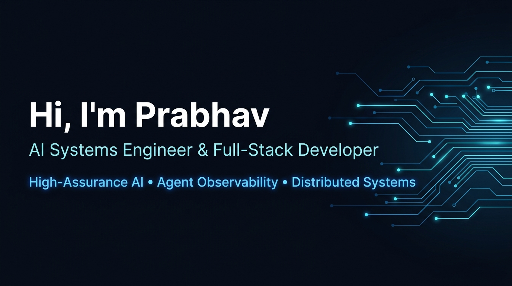
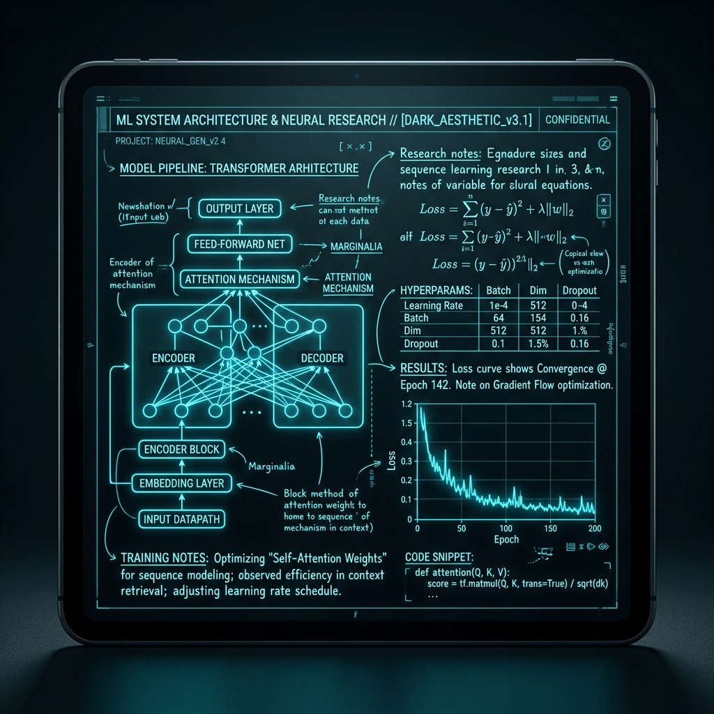
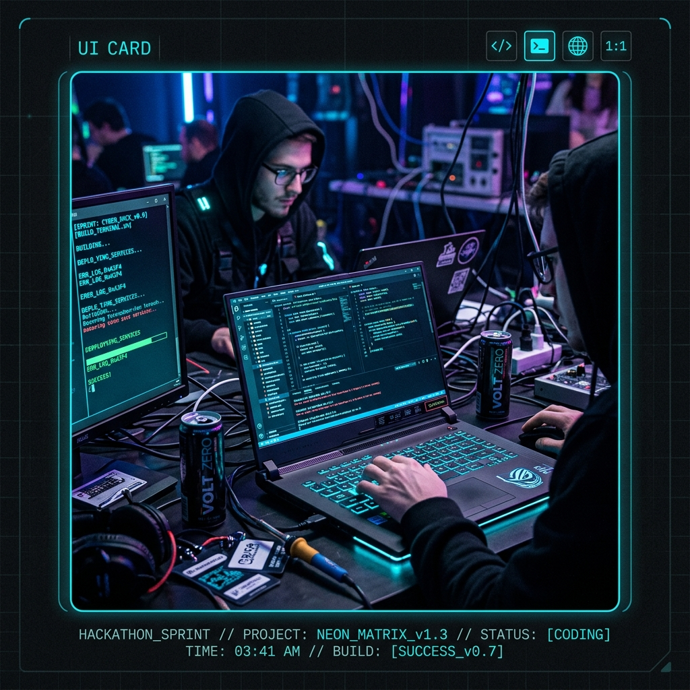

<div align="center">



<br><br>

<p align="center">
  <a href="https://github.com/prabhavkrishna17-max"><code>⚡ GitHub: @prabhavkrishna17-max</code></a>
  &nbsp;&nbsp;&nbsp;&nbsp;
  <a href="mailto:prabhavkrishna17@gmail.com"><code>✉️ Email: prabhavkrishna17@gmail.com</code></a>
</p>

<p align="center">
  <em>Specializing in High-Assurance Agentic RAG Architectures, AI Observability Workbenches, and Statistical Forecasting Engines.</em>
</p>

</div>

---

### 📌 About Me

AI Systems Engineer and Full-Stack Developer focused on building resilient, high-assurance distributed systems and developer tooling. My core technical pursuits lie at the intersection of domain-conditioned retrieval, telemetry-driven AI observability, and macroeconomic statistical indexing.

#### 💡 What Drives Me
Passionate about engineering systems where **"the bar is verifiability, not fluency."** Whether architecting domain-conditioned retrieval pipelines that eliminate hallucinations, building interactive execution-tree diagnostics for multi-agent workflows, or indexing high-frequency market data, I believe developer tools and AI infrastructure should deliver uncompromising mathematical and structural reliability.

---

### ⚡ Featured Projects

<table>
  <tr>
    <td width="50%" valign="top">
      <h3>🏛️ <a href="https://github.com/prabhavkrishna17-max/Hacknex26">Hacknex26 — HNX Legal Intelligence</a></h3>
      <p><strong>Agentic Legal Assistant (Track HNX26EPS01)</strong></p>
      <p>High-assurance legal intelligence and document analysis platform eliminating hallucinated claims through verifiable cross-reference citations and calibrated abstention.</p>
      <strong>Key Engineering & Impact:</strong>
      <ul>
        <li>Implemented <strong>JC-PAR</strong> architecture (Jurisdiction-Conditioned Precedence-Aware RAG) with calibrated abstention returning <code>INSUFFICIENT_EVIDENCE</code> on incomplete records.</li>
        <li>Blended BM25 lexical ranking and dense embeddings via Reciprocal Rank Fusion (RRF).</li>
        <li>Automated clause-precedence dependency graph expansion handling statutory carveouts (<em>"Notwithstanding Section X"</em>).</li>
      </ul>
      <p><strong>Tech Stack:</strong> <code>Python 3.11+</code>, <code>FastAPI</code>, <code>React 19</code>, <code>BM25</code>, <code>Gemini API</code>, <code>PyMuPDF</code></p>
      <p><a href="https://github.com/prabhavkrishna17-max/Hacknex26"><strong>Explore Repository →</strong></a></p>
    </td>
    <td width="50%" valign="top">
      <h3>🔭 <a href="https://github.com/prabhavkrishna17-max/AgentLens">AgentLens</a></h3>
      <p><strong>AI-Agent Observability & Failure-Diagnosis Workbench</strong></p>
      <p>Unified developer workbench to observe, trace, diagnose, refine, and compare autonomous AI agent executions through interactive telemetry graphs.</p>
      <strong>Key Engineering & Impact:</strong>
      <ul>
        <li>Constructed interactive decision-tree graph visualizations for multi-step agent runs, tool calls, and LLM completions.</li>
        <li>Engineered automated root-cause failure classification and diagnostic hints based on observed traces.</li>
        <li>Authored drop-in multi-provider Python SDK (<code>agentlens_sdk</code>) instrumenting OpenAI, Anthropic, and Gemini models.</li>
      </ul>
      <p><strong>Tech Stack:</strong> <code>FastAPI</code>, <code>PostgreSQL</code>, <code>SQLAlchemy</code>, <code>React 18</code>, <code>React Flow</code>, <code>Python SDK</code></p>
      <p><a href="https://github.com/prabhavkrishna17-max/AgentLens"><strong>Explore Repository →</strong></a></p>
    </td>
  </tr>
  <tr>
    <td width="50%" valign="top">
      <h3>✈️ <a href="https://github.com/prabhavkrishna17-max/AEROVA">AEROVA (AERIX SIH26056)</a></h3>
      <p><strong>Real-Time Airfare Observation & Valuation Analytics</strong></p>
      <p>Macroeconomic market intelligence engine augmenting India’s Consumer Price Index (CPI) with high-frequency airfare dynamics across national routes.</p>
      <strong>Key Engineering & Impact:</strong>
      <ul>
        <li>Tracked real-time fare dynamics across major city-pairs and advance booking windows (T+1 to T+45).</li>
        <li>Formulated statistical route price indexing weighted with DGCA passenger traffic figures.</li>
        <li>Engineered multi-adapter scraping pipelines with outlier filtering, rate-limiting, and backtesting harnesses.</li>
      </ul>
      <p><strong>Tech Stack:</strong> <code>Python</code>, <code>FastAPI</code>, <code>PostgreSQL</code>, <code>Next.js</code>, <code>Docker</code>, <code>Statistical Indexing</code></p>
      <p><a href="https://github.com/prabhavkrishna17-max/AEROVA"><strong>Explore Repository →</strong></a></p>
    </td>
    <td width="50%" valign="top">
      <h3>🧵 <a href="https://github.com/prabhavkrishna17-max/GenWeave-AI">GenWeave AI</a></h3>
      <p><strong>Generative 3D Material Staging & Render Pipeline</strong></p>
      <p>Full-stack material synthesis studio translating raw surface textures and natural language prompts into staged 3D product renders.</p>
      <strong>Key Engineering & Impact:</strong>
      <ul>
        <li>Engineered asynchronous job queue orchestration (<code>/api/generate</code>, <code>/api/status</code>, <code>/api/result</code>) for non-blocking rendering.</li>
        <li>Developed dark-mode glassmorphic interface with interactive material property tuning (roughness, specular, grain scale).</li>
        <li>Constructed multipart upload pipeline handling high-resolution texture maps and prompt configurations.</li>
      </ul>
      <p><strong>Tech Stack:</strong> <code>FastAPI</code>, <code>SQLite</code>, <code>React 18</code>, <code>Tailwind CSS</code>, <code>Vite</code></p>
      <p><a href="https://github.com/prabhavkrishna17-max/GenWeave-AI"><strong>Explore Repository →</strong></a></p>
    </td>
  </tr>
</table>

---

### 🛠️ Tech Stack

<div align="center">

<h4>Frontend Development</h4>


<br><br>

<h4>Backend & Systems Architecture</h4>


<br><br>

<h4>Database, DevOps & Tooling</h4>


<br><br>

<h4>AI, Retrieval & Machine Learning</h4>
<p align="center">
  <code>⚡ Gemini API</code> &nbsp;
  <code>🧠 Hybrid RRF RAG</code> &nbsp;
  <code>🔍 BM25 Lexical</code> &nbsp;
  <code>📐 Dense Embeddings</code> &nbsp;
  <code>📊 Sentence Transformers</code> &nbsp;
  <code>📄 PyMuPDF</code>
</p>

</div>

---

### 📊 GitHub Analytics

<div align="center">

<p align="center">
  
</p>

<table border="0">
  <tr>
    <td align="center" width="50%">
      
    </td>
    <td align="center" width="50%">
      
    </td>
  </tr>
</table>

</div>

---

### 💻 Current Focus & Interests

```javascript
const DEV = {
  name: "Prabhav Krishna",
  role: "AI Systems Engineer & Full-Stack Developer",
  current_focus: [
    "High-Assurance Agentic RAG (JC-PAR)",
    "Telemetry-Driven Observability & Failure Diagnosis",
    "High-Frequency Market Intelligence Pipelines"
  ],
  actively_building: [
    "AgentLens: AI Agent Execution Observability Workbench",
    "Hacknex26: Evidentiary Legal Notice Intelligence",
    "AEROVA: Real-Time Airfare Statistical Valuation Index"
  ],
  core_architecture: [
    "Reciprocal Rank Fusion (BM25 + Dense Vectors)",
    "Clause-Precedence Dependency Graphs",
    "Calibrated Abstention on Low-Evidence Records"
  ],
  learning_curve: [
    "Autonomous Multi-Agent Consensus Protocols",
    "Kernel-Level Telemetry & Distributed Tracing"
  ]
};
```

---

### 🌐 Beyond Code

<table border="0" width="100%">
  <tr>
    <td align="center" width="25%" valign="top">
      <br><br>
      <strong>Photography</strong><br>
      <sub>Perspective, geometry & urban lighting</sub>
    </td>
    <td align="center" width="25%" valign="top">
      <br><br>
      <strong>Hardware & Workspace</strong><br>
      <sub>Ergonomics, mechanical switches & tooling</sub>
    </td>
    <td align="center" width="25%" valign="top">
      <br><br>
      <strong>Systems Research</strong><br>
      <sub>Dissecting ML papers & architectures</sub>
    </td>
    <td align="center" width="25%" valign="top">
      <br><br>
      <strong>Hackathons & Sprints</strong><br>
      <sub>Zero-to-one engineering & prototyping</sub>
    </td>
  </tr>
</table>

---

### 🤝 Connect With Me

<div align="center">

<p align="center">
  Always open to discussing high-assurance AI systems, distributed architectures, or technical collaborations.
</p>

<p align="center">
  <a href="https://github.com/prabhavkrishna17-max"><code>⚡ GitHub: @prabhavkrishna17-max</code></a>
  &nbsp;&nbsp;&nbsp;&nbsp;
  <a href="mailto:prabhavkrishna17@gmail.com"><code>✉️ Email: prabhavkrishna17@gmail.com</code></a>
</p>

<br>


<sub>Engineered with verifiable rigor, precision telemetry, and clean architectural principles.</sub><br>
<sub>© 2026 Prabhav Krishna. Built for continuous iteration.</sub>

</div>
